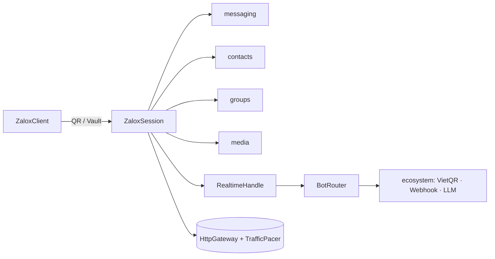

<div align="center">

# 🦀 zalox

**Unofficial Zalo API for Rust** — async, typed, and dependency-light.

*Đăng nhập QR · Nghe sự kiện realtime · Gửi tin / ảnh / nhóm · Bot framework · VietQR — viết 100% bằng Rust.*

[](https://github.com/kelvin9899-is/zalox/actions)
[](https://www.rust-lang.org)
[](#license)
[](#)
[](#status)

[Quick start](#-quick-start) · [Features](#-features) · [Architecture](#-architecture) · [So sánh](#-so-sánh) · [Roadmap](#-roadmap) · [Tác giả](#-tác-giả)

</div>

---

> [!WARNING]
> **zalox là thư viện không chính thức**, không liên kết với VNG/Zalo. Tự động hóa tài khoản cá nhân có thể vi phạm điều khoản dịch vụ và dẫn tới bị hạn chế hoặc khóa tài khoản. Hãy dùng tài khoản phụ khi thử nghiệm. Với sản phẩm thương mại, ưu tiên **Zalo OA / Zalo Bot Platform** chính thức.

## ✨ Features

| | |
|---|---|
| 🔐 **Đăng nhập QR** | Luồng quét QR bất đồng bộ, hỗ trợ quét xác nhận lần hai, sự kiện `QrReady` / `Scanned` / `Authenticated` |
| 🗄️ **Session Vault `ZLX1`** | Lưu phiên đã mã hóa (PBKDF2-HMAC-SHA256 + AES-256-GCM), không lưu cookie dạng thuần văn bản |
| ⚡ **Realtime** | WebSocket nhị phân, giải mã AES-GCM + inflate, heartbeat, tự reconnect và xoay endpoint |
| 💬 **Messaging** | Rich-text, `@mention`, trích dẫn, thu hồi, xóa, chuyển tiếp, reaction, sticker, typing |
| 👥 **Contacts & Groups** | Tìm theo SĐT, hồ sơ, bạn bè, tạo/đổi tên nhóm, thêm/xóa thành viên, bình chọn |
| 🖼️ **Media** | Đọc kích thước PNG/JPEG/GIF/WebP trực tiếp từ header (không cần `sharp`/`libvips`), upload chia chunk |
| 🛡️ **Traffic pacing** | `PacingPolicy` giãn cách + jitter ngẫu nhiên cho mọi request ghi |
| 🤖 **BotRouter** | Lệnh theo tiền tố, state dùng chung `Arc<S>`, tự gửi typing trước khi trả lời |
| 🇻🇳 **Hệ sinh thái VN** | VietQR EMVCo offline, xác thực webhook payOS / SePay, cầu nối LLM (Groq, OpenRouter, Gemini) |

## 🚀 Quick start

```toml
[dependencies]
zalox = { git = "https://github.com/kelvin9899-is/zalox" }
tokio = { version = "1", features = ["full"] }
```

### Đăng nhập một lần, dùng mãi

```rust
use zalox::prelude::*;

#[tokio::main]
async fn main() -> ZaloxResult<()> {
    let client = ZaloxClient::builder()
        .pacing(PacingPolicy::human_like())
        .build();

    let session = if std::path::Path::new("account.zlx").exists() {
        client.login_with_vault("account.zlx", "passphrase").await?
    } else {
        let s = client
            .login_with_qr(|ev| {
                if let QrAuthEvent::QrReady { png_bytes, .. } = ev {
                    let _ = std::fs::write("qr.png", png_bytes);
                    println!("Quét qr.png bằng app Zalo");
                }
            })
            .await?;
        s.save_vault("account.zlx", "passphrase").await?;
        s
    };

    println!("UID: {}", session.uid());
    Ok(())
}
```

### Bot trong 20 dòng

```rust
use zalox::prelude::*;

#[tokio::main]
async fn main() -> ZaloxResult<()> {
    let session = ZaloxClient::default()
        .login_with_vault("account.zlx", "passphrase")
        .await?;

    let router = BotRouter::new("!")
        .command("ping", |ctx, _| async move {
            ctx.react(ReactionKind::Heart).await?;
            ctx.quote_reply("pong 🏓").await?;
            Ok(())
        })
        .command("pay", |ctx, args| async move {
            let vnd = args.first().and_then(|s| s.parse().ok()).unwrap_or(50_000);
            let qr = VietQrOrder::new(VnBank::MBBank, "0987654321").amount(vnd).memo("THANHTOAN");
            ctx.quote_reply(qr.to_vietqr_image_url()).await?;
            Ok(())
        });

    session.run_bot(router).await
}
```

### Tin nhắn định dạng kiểu builder

```rust
session.messaging()
    .compose(Peer::group("GROUP_ID"))
    .text("Thông báo quan trọng @All")
    .bold(0..18)
    .mention_all(19, 4)
    .urgency(MessageUrgency::Important)
    .send()
    .await?;
```

Chạy thử không cần đăng nhập: `cargo run --example vietqr_ai_assistant`

## 🏗️ Architecture



```text
src/
├─ auth/       QR flow, credentials
├─ cipher/     AES-CBC session cipher, WS frame codec, ZLX1 vault
├─ transport/  HttpGateway (cookies, version probe), TrafficPacer
├─ realtime/   WebSocket supervisor + typed events
├─ services/   messaging · contacts · groups · media
├─ bot/        BotRouter
└─ ecosystem/  vietqr · webhook · ai_bridge
```

## 📊 So sánh

| | **zalox** (Rust) | zca-js (JS/TS) | zlapi (Python) |
|---|---|---|---|
| Runtime | Binary native | Node / Bun | CPython |
| Đóng gói | 1 file thực thi | cần Node + `node_modules` | cần Python + pip |
| Kiểu dữ liệu | Tĩnh, kiểm tra lúc biên dịch | TypeScript | Động |
| Xử lý ảnh | Pure-Rust đọc header | `sharp` (tùy chọn) | tùy thư viện |
| Độ trưởng thành | **v0.1, chưa kiểm thử rộng** | Lâu đời, cộng đồng lớn | Lâu đời |
| Số API phủ | Tập lõi (xem roadmap) | Rất rộng | Rộng |

> zalox mới ở giai đoạn đầu. Nếu cần phủ API rộng và ổn định ngay hôm nay, zca-js và zlapi vẫn là lựa chọn trưởng thành hơn.

## <a id="status"></a>🧪 Status

- ✅ Biên dịch sạch, `cargo clippy -- -D warnings` sạch, 12 unit test đạt (mã hóa, frame, vault, VietQR, webhook, image probe).
- ⚠️ **Chưa xác minh đầu-cuối với máy chủ Zalo thật** (đăng nhập QR, WebSocket, gửi tin). Các endpoint và định dạng gói tin dựa trên nghiên cứu giao thức; Zalo có thể đổi bất cứ lúc nào. Báo lỗi qua Issues kèm log.
- ⚠️ Chưa đo hiệu năng/bộ nhớ; chưa có benchmark.

## 🗺️ Roadmap

- [ ] Kiểm thử đầu-cuối đăng nhập + gửi/nhận tin, ghi nhận lỗi giao thức
- [ ] Phủ thêm API: sticker catalog, tin nhắn cũ, nhóm nâng cao, nhãn, tự động trả lời
- [ ] Gửi video/tệp qua `file_done` kèm test
- [ ] Binding Python (PyO3) và JS (napi-rs) trên cùng lõi Rust
- [ ] Publish lên crates.io, tài liệu docs.rs

## 🤝 Contributing

PR và issue đều được chào đón. Trước khi gửi: `cargo fmt && cargo clippy --all-targets -- -D warnings && cargo test`.

## 👤 Tác giả

**Phương** — [@kelvin9899-is](https://github.com/kelvin9899-is)

Lập trình viên người Việt, thích dựng công cụ tự động hóa nhỏ gọn, chạy độc lập và dễ triển khai trên Windows. `zalox` ra đời từ mong muốn có một bộ SDK Zalo viết bằng Rust, đóng gói thành một file thực thi duy nhất, không kéo theo Node hay Python.

## 🙏 Acknowledgements

Giao thức Zalo Web được nghiên cứu từ các dự án mã nguồn mở [zca-js](https://github.com/RFS-ADRENO/zca-js) (MIT) và [zlapi](https://github.com/Its-VrxxDev/zlapi) (MIT). `zalox` là bản viết lại bằng Rust với kiến trúc riêng, nhưng các hằng số giao thức và định dạng gói tin xuất phát từ công trình của các tác giả đó. Xin cảm ơn họ.

## License

Dual-licensed under [MIT](LICENSE-MIT) or [Apache-2.0](LICENSE-APACHE).
